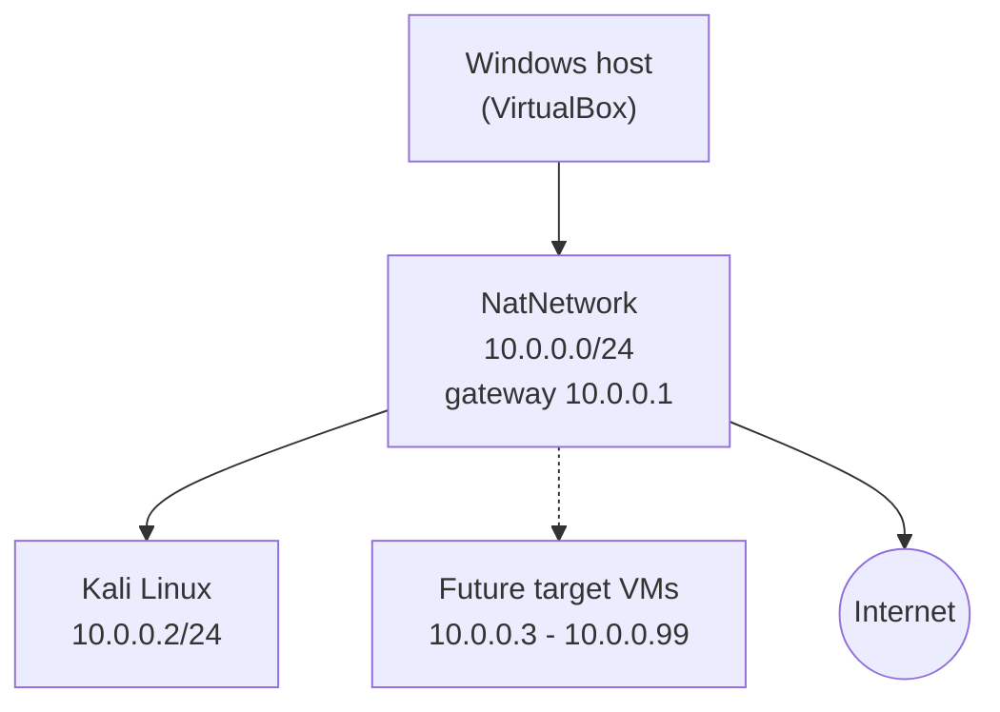

<div align="center">

# 🔐 WK1-PM1: Cybersecurity Lab Environment Setup

**An isolated VirtualBox lab with Kali Linux for penetration testing and ethical hacking practice**
</div>

<p align="center">
  
  
  
  
  
  
  
  
</p>

---

## 📌 Project Overview

This project sets up a **virtual cybersecurity and penetration-testing lab** using VirtualBox and Kali Linux, as the first task of the Networkwalks program (Week 1, Project Module 1).

The lab runs on a private virtual network so that more machines can be added later and used as targets for authorized security testing. Everything in this write-up was built and verified on my own machine,.

---

## 🎯 Objectives

- Install and configure VirtualBox on the host machine.
- Import Kali Linux as the attacking machine.
- Create a private **NAT Network** on `10.0.0.0/24`.
- Assign Kali the fixed IP address `10.0.0.2/24`.
- Enable the shared clipboard, drag and drop, and a shared `Downloads` folder.
- Confirm full Internet access from Kali.
- Take a snapshot as a recovery point.
- Document the process, including the problems I hit and how I fixed them.

---

## 🏗️ Lab Architecture



Additional target machines can join the same NAT Network in later projects.

---

## ⚙️ Lab Configuration

| 🧩 Component | ⚙️ Configuration |
| --- | --- |
| 🖥️ Host OS | Windows 11 Pro |
| 🧠 Host RAM | 16 GB |
| ⚡ Processor | Intel Core i5-8365U @ 1.60 GHz |
| 🧰 Hypervisor | Oracle VirtualBox 7.2.16 |
| 🐉 Security OS | Kali Linux 2026.2 (prebuilt VirtualBox image, amd64) |
| 🧠 Kali RAM / CPUs | 2048 MB / 2 |
| 🔌 Network adapter | Adapter 1, NAT Network `NatNetwork`, Intel PRO/1000 MT Desktop, Promiscuous Mode: Allow All |
| 📡 Network address | 10.0.0.0/24 (DHCP enabled on the NAT Network) |
| 🐧 Kali IP address | 10.0.0.2/24 (static) |
| 🚪 Default gateway | 10.0.0.1 |
| 🌍 DNS server | 8.8.8.8 |
| 📁 Shared folder | Host `Downloads` mounted in Kali at `/media/sf_Downloads` |
| 📋 Clipboard / Drag and drop | Bidirectional |

---

# 🪜 Lab Setup Procedure

## Step 1. Install 7-Zip

The Kali VirtualBox image is distributed as a `.7z` archive, so I installed the 64-bit Windows `.exe` installer of 7-Zip to extract it.

---

## Step 2. Install VirtualBox

I installed the latest stable VirtualBox from the official site. Hardware virtualization (VT-x / AMD-V) was already enabled on my machine, so the VM ran without any BIOS changes.

---

## Step 3. Create the NAT Network

In **File → Tools → Network → NAT Networks**, I created:

```text
Network Name: NatNetwork
IPv4 Prefix:  10.0.0.0/24
DHCP:         Enabled
IPv6:         Disabled
```

A **NAT Network** was chosen over plain NAT because VMs attached to the same NAT Network can talk to each other while still reaching the Internet through the host. That is what a multi-machine attack-and-target lab needs.

---

## Step 4. Import and Configure Kali Linux

I downloaded the prebuilt **VirtualBox 64-bit** image from kali.org, extracted it with 7-Zip, and added the `.vbox` file to VirtualBox. Before relying on it, I changed the VM settings.

**Network:** Adapter 1 attached to the NAT Network.

```text
Adapter 1
Attached to:      NAT Network
Name:             NatNetwork
Adapter Type:     Intel PRO/1000 MT Desktop
Promiscuous Mode: Allow All
```

**Clipboard and drag and drop:** both set to Bidirectional under *General → Features*.

**Shared folder:** the host `Downloads` folder was added as a global shared folder with Auto-mount, so it appears in Kali automatically.

---

## Step 5. Configure the Kali Linux Network

In Kali, I edited **Wired connection 1** (*Edit Connections → IPv4 Settings*), set the method to **Manual**, and entered:

```text
IP Address:  10.0.0.2
Subnet Mask: 24 (255.255.255.0)
Gateway:     10.0.0.1
DNS:         8.8.8.8
```

Activating this configuration failed at first. The cause and the fix are covered in the troubleshooting section below.

---

## Step 6. Create a VM Snapshot

After everything was working, I took a VirtualBox snapshot named:

```text
Kali-configured-10.0.0.2-WK1-PM1
```

If a later exercise breaks the VM, I can restore this known-good baseline. I tested it by restoring the snapshot and running `ip a`, which again showed `10.0.0.2/24` on `eth0`.

---

# 🔎 Lab Verification

| ✅ Test | 🧾 Command | 🎯 Result |
| --- | --- | --- |
| IP address | `ip a` | `eth0` has only `10.0.0.2/24` |
| Default route | `ip route` | `default via 10.0.0.1 dev eth0` |
| Internet through the NAT Network | `ping -I eth0 -c 4 8.8.8.8` | 4 of 4 replies, 0% packet loss |
| DNS resolution | `ping -c 4 google.com` | Name resolves, 0% packet loss |
| Gateway reachable | `ping -c 4 10.0.0.1` | 4 of 4 replies, 0% packet loss, about 1 ms |
| DNS lookup | `nslookup networkwalks.com` | Resolved through 8.8.8.8 to 192.232.216.135 |
| Nmap installed | `nmap --version` | Nmap 7.99 |
| Snapshot restore | Restore the snapshot, then `ip a` | Baseline restored, `eth0` back at `10.0.0.2/24` |
| Shared folder | `ls /media/sf_Downloads` | Host `Downloads` files are listed |
| Clipboard and drag and drop | Copy/paste both ways, drag a file in | Both work |

### Final Network State

```text
IP Address:  10.0.0.2/24
Gateway:     10.0.0.1
DNS:         8.8.8.8
```

---

# 🐞 Problems Encountered & Solutions

## Problem 1. NAT Network still showed the default `10.0.2.0/24`

I typed `10.0.0.0/24` into the IPv4 Prefix box, but the list still showed VirtualBox's default `10.0.2.0/24`.

**Cause:** the change was not saved until I clicked **Apply**.

**Fix:** click Apply and confirm the list reads `10.0.0.0/24`. This matters because `10.0.0.2` would sit outside a `10.0.2.0/24` network and Kali would have no working gateway.

---

## Problem 2. Method left on Automatic (DHCP)

I entered `10.0.0.2` while the IPv4 method was still **Automatic (DHCP)**. The dialog then labelled the section *Additional static addresses*, which means Kali would take a DHCP address and keep `10.0.0.2` as a second one.

**Fix:** change the method to **Manual**, so `10.0.0.2` is the single fixed address.

---

## Problem 3. Connection activation failed after the static IP

Bringing the connection back up failed:

```text
Error: Connection activation failed: IP configuration could not be reserved (no available address, timeout, etc.)
```

**Cause:** NetworkManager runs Duplicate Address Detection (DAD) before using a static address, and on this VirtualBox 7 and Kali 2026 combination that check stalls on a NAT Network.

**Fix:** disable the DAD wait, then bring the connection up again:

```bash
sudo nmcli connection modify "Wired connection 1" ipv4.dad-timeout 0
sudo nmcli connection up "Wired connection 1"
```

- `modify ... ipv4.dad-timeout 0` sets the duplicate-address check timeout to zero.
- `connection up` re-activates the connection with the new setting.

The output was `Connection successfully activated`, and Internet access worked right away.

> Connection names can differ between systems. Run `nmcli connection show` first to find the real name.

---

## Problem 4. An unexpected second network adapter

After the static IP worked, `ip a` showed a second interface, `eth1`, with `192.168.208.30/24`. The lab design uses a single NAT Network adapter.

**Check:** `ip route` showed the only default route was `via 10.0.0.1 dev eth0`, so `eth1` was not carrying Internet traffic. `ping -I eth0` also succeeded, which proved `eth0` worked on its own.

**Fix:** I disabled the extra adapter in the VM's network settings. `ip a` then showed only `lo` and `eth0`.

---

# 💡 What I Learned

### 1. NAT vs NAT Network
Plain NAT isolates each VM. A NAT Network lets VMs on the same virtual network reach each other while still getting Internet access, which is what a multi-machine lab needs.

### 2. Static IP configuration
A static address needs the method set to Manual, a correct netmask, a gateway inside the subnet, and a DNS server. Leaving it on DHCP produces a confusing mixed setup.

### 3. Reading errors and logs
The activation error pointed to a real NetworkManager behavior, DAD. Searching for the exact error text and testing the fix is the same habit I will need for troubleshooting in a SOC.

### 4. Verifying in layers
Testing the interface (`ip a`), the route (`ip route`), raw Internet (`ping 8.8.8.8`), and DNS (`ping google.com`) separately shows exactly which layer fails.

### 5. Snapshots
A snapshot taken after a verified configuration is the recovery point to return to before any risky experiment.

### 6. Documentation
Screenshots and commands recorded as I worked made this write-up much faster, and the failures turned out to be the most useful part to record.

---

# 🔐 Security & Ethical Use

This lab is for education and practice only. Its tools must only be used against systems I own or have explicit permission to test.

---

# 🔗 Tools & Resources

- **7-Zip:** [https://7-zip.org/download.html](https://7-zip.org/download.html)
- **VirtualBox:** [https://virtualbox.org/wiki/Downloads](https://virtualbox.org/wiki/Downloads)
- **Kali Linux:** [https://kali.org/get-kali](https://kali.org/get-kali)

---

# 👤 Author

**Marshel Mburu Macharia**

LinkedIn: [https://www.linkedin.com/in/marshel-macharia-a8a508327/](https://www.linkedin.com/in/marshel-macharia-a8a508327/)
GitHub: [https://github.com/marshel-macharia](https://github.com/marshel-macharia)

---

## 📌 Project Information

**Program:** Cybersecurity at Networkwalks | **Week:** 01 | **Project:** WK1-PM1, Lab Setup with VirtualBox and Kali Linux | **Repository:** GitHub